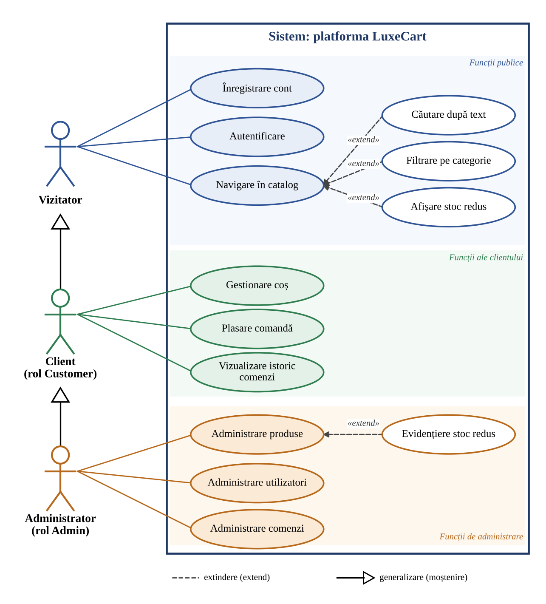
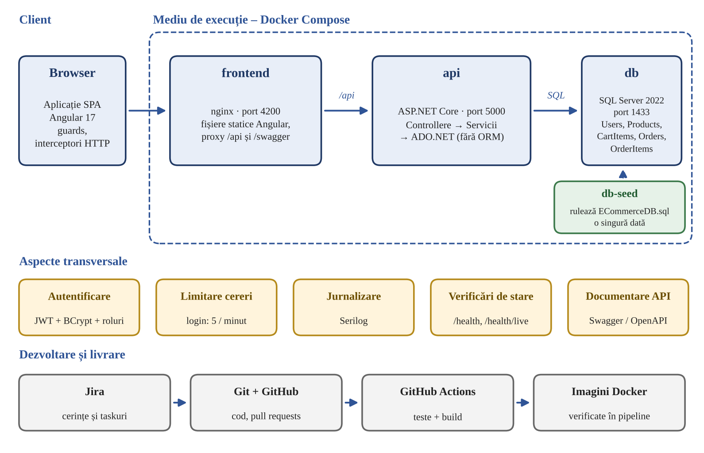

# LuxeCart

[](https://github.com/cristiancjcr/LuxeCart-E-COMMERCE-WEB-APP/actions/workflows/ci.yml)

E-commerce web application: an Angular 17 single-page app, an ASP.NET Core Web API and a SQL Server database,
built as the semester project for *Instrumente pentru dezvoltarea programelor*.

## Features

- **Visitor:** registration, login, product catalog with search, category filter and pagination.
- **Customer:** server-side shopping cart, checkout with a shipping address, order history.
- **Administrator:** product management, user management (roles, deletion) and order management (status updates).
- The order total is always computed on the server from the prices stored in the database.

The full specification (actors, use cases, requirements) is in [`docs/specificatii.md`](docs/specificatii.md).



## Technology stack

| Layer     | Technology                                                       |
|-----------|------------------------------------------------------------------|
| Frontend  | Angular 17 (standalone components, signals), TypeScript, RxJS    |
| Backend   | ASP.NET Core Web API (.NET 8), raw ADO.NET (no ORM), Serilog     |
| Database  | Microsoft SQL Server 2022                                        |
| Security  | JWT Bearer, BCrypt password hashing, rate limiting on login      |
| Tests     | xUnit, Moq, FluentAssertions (backend); Jasmine, Karma (frontend)|
| Delivery  | Docker, Docker Compose, nginx, GitHub Actions                    |
| Process   | Jira (project key `LUX`), GitHub pull requests                   |

Target architecture:



## Repository layout

```
backend/    ASP.NET Core API (ECommerceAPI) and its tests (ECommerceAPI.Tests)
frontend/   Angular application
database/   SQL schema and seed data (ECommerceDB.sql)
docs/       specification, diagrams, traceability
.github/    CI workflow and pull request template
```

## Running the project

### Option 1: Docker Compose (everything at once)

Requires Docker Desktop. From the repository root:

```
docker compose up --build
```

| Service  | Address                      |
|----------|------------------------------|
| Frontend | http://localhost:4200        |
| API      | http://localhost:5000        |
| Health   | http://localhost:5000/health |
| Database | localhost:1433 (SQL Server)  |

The compose file starts SQL Server, runs a one-shot seed service that executes `database/ECommerceDB.sql`,
then starts the API and the nginx-served frontend (which proxies `/api` to the API).
Optional settings (`DB_PASSWORD`, `JWT_SECRET`) can be provided through a `.env` file; copy `.env.example` and do not commit the real file.
Stop the stack with `docker compose down`.

### Option 2: local development

1. Create the database by running `database/ECommerceDB.sql` on your SQL Server or LocalDB instance
   (the script drops and recreates the database).
2. Start the API from Visual Studio (open `backend/ECommerce.sln`) or with `dotnet run` in `backend/ECommerceAPI`.
   Swagger is available at `/swagger`.
3. In `frontend/`: `npm ci`, then `npm start` and open http://localhost:4200.

### Default administrator account

On first start the API creates an administrator: `admin@luxecart.com` / `Admin@123`.
This is a development account; change the password before any real deployment.
Customer accounts are created from the registration page.

## Tests

| Part     | Command                                                         |
|----------|-----------------------------------------------------------------|
| Backend  | `dotnet test backend/ECommerce.sln`                             |
| Frontend | `npm test -- --watch=false --browsers=ChromeHeadless` in `frontend/` |

The same checks run on every push to `main` and on every pull request through
[GitHub Actions](.github/workflows/ci.yml): backend build and tests on .NET 8, frontend tests and production build
on Node 20, and a build of both Docker images.

## Working agreement and traceability

- Planning is done in Jira (project key `LUX`); every change starts from a Jira issue.
- Branches: `feature/LUX-<n>-<short-name>` or `bugfix/LUX-<n>-<short-name>`; work reaches `main` through a pull request (merge commit).
- Commit messages and pull request titles start with the issue key, for example `LUX-23 Add CI pipeline with GitHub Actions`.
- Pull requests follow [`.github/pull_request_template.md`](.github/pull_request_template.md) and state only what was actually tested.
- The mapping between Jira issues and the work delivered is in [`docs/traceability.md`](docs/traceability.md).
- Report milestones are marked with tags: `raport-1`, `raport-2`, `raport-final`.

## License

See [`LICENSE`](LICENSE).
