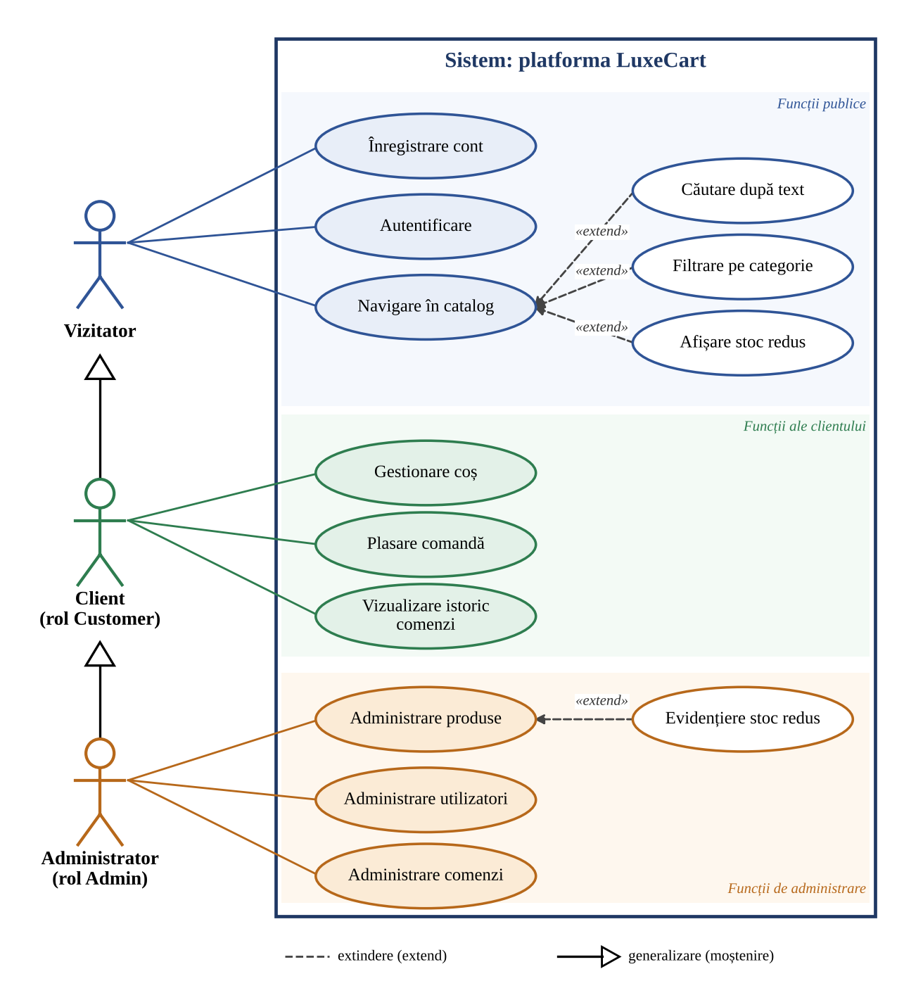
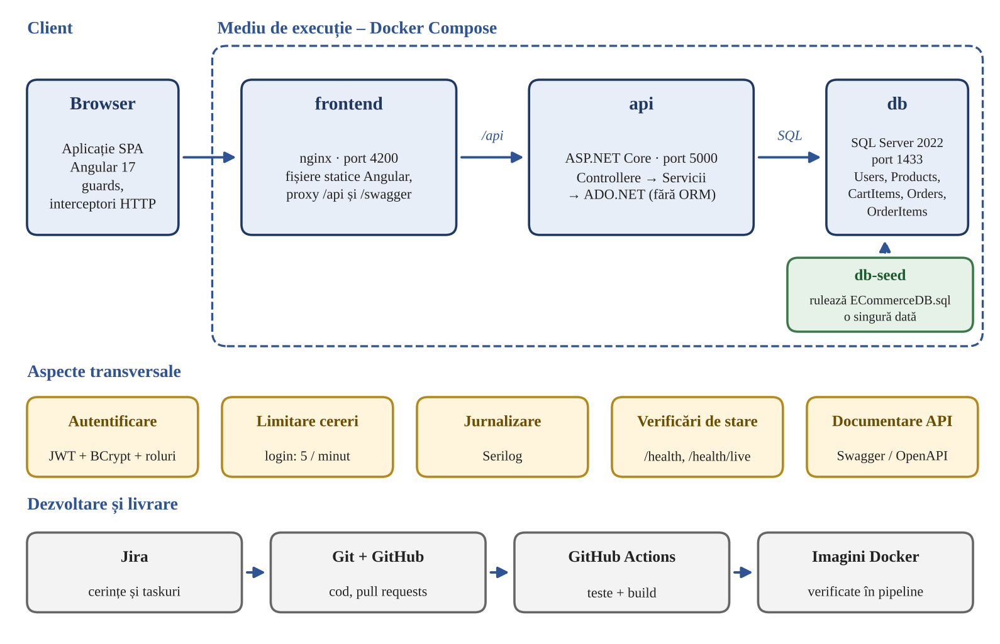

# Specificații – LuxeCart

Document de referință pentru cerințele aplicației. Versiunea detaliată se află în Raportul 1.

## 1. Actori

| Actor | Autentificare | Capacități |
|-------|---------------|------------|
| Vizitator | Nu este necesară | Înregistrare, autentificare, navigare în catalog (cu căutare și filtrare). |
| Client | Cont autentificat, rol `Customer` | Capacitățile Vizitatorului, plus gestionarea coșului, plasarea comenzilor și consultarea istoricului. |
| Administrator | Cont autentificat, rol `Admin` | Capacitățile Clientului, plus administrarea produselor, utilizatorilor și comenzilor. |

## 2. Diagrama cazurilor de utilizare

## 3. Cazuri de utilizare

| ID | Caz de utilizare | Actor | Descriere |
|----|------------------|-------|-----------|
| UC-01 | Înregistrare cont | Vizitator | Creează un cont cu nume, prenume, e-mail și parolă; contul primește rolul `Customer`, iar utilizatorul este autentificat automat. |
| UC-02 | Autentificare | Vizitator | Obține un token JWT pe baza e-mailului și a parolei. |
| UC-03 | Navigare în catalog | Vizitator | Consultă lista paginată de produse (12 pe pagină). |
| UC-04 | Căutare după text | Vizitator | Restrânge lista după un text căutat în nume și descriere (extinde UC-03). |
| UC-05 | Filtrare pe categorie | Vizitator | Afișează doar produsele unei categorii (extinde UC-03). |
| UC-06 | Afișare stoc redus | Vizitator | Etichete pentru stoc sub 10 bucăți și stoc epuizat (extinde UC-03). |
| UC-07 | Gestionare coș | Client | Adaugă produse, modifică cantitatea, elimină produse; coșul este păstrat pe server. |
| UC-08 | Plasare comandă | Client | Transformă coșul într-o comandă, cu adresă de livrare; totalul se calculează pe server. |
| UC-09 | Vizualizare istoric comenzi | Client | Consultă comenzile proprii, cu produse, total, adresă și stare. |
| UC-10 | Administrare produse | Administrator | Adaugă, modifică și șterge produse. |
| UC-11 | Evidențiere stoc redus | Administrator | Stocul sub 10 bucăți este afișat cu roșu în lista de administrare (extinde UC-10). |
| UC-12 | Administrare utilizatori | Administrator | Listează utilizatorii, schimbă rolul și șterge conturi; contul principal este protejat. |
| UC-13 | Administrare comenzi | Administrator | Vizualizează toate comenzile și actualizează starea lor. |

## 4. Cerințe funcționale

Prioritate MoSCoW: M = obligatoriu, S = recomandat.

| ID | Cerință | Caz de utilizare | Prioritate |
|----|---------|------------------|------------|
| CF-01 | Înregistrare cu nume, prenume, e-mail unic și parolă de cel puțin 6 caractere; parola se stochează sub formă de hash. | UC-01 | M |
| CF-02 | Autentificare și emitere de token JWT; coșul, comanda și istoricul sunt accesibile doar utilizatorilor autentificați. | UC-02 | M |
| CF-03 | Roluri `Customer` și `Admin`; panoul de administrare și endpoint-urile `/api/admin` sunt accesibile doar administratorilor. | UC-02, UC-10–13 | M |
| CF-04 | Catalog paginat, cu căutare după text, filtrare pe categorie și etichete pentru stoc redus sau epuizat. | UC-03–06 | M |
| CF-05 | Coș persistent pentru fiecare utilizator: adăugare, modificare a cantității, eliminare. | UC-07 | M |
| CF-06 | Comandă cu adresă de livrare, cu total calculat pe server și scriere atomică a comenzii și a liniilor ei; coșul se golește. | UC-08 | M |
| CF-07 | Istoricul comenzilor utilizatorului, cu stare (`Pending`, `Shipped`, `Delivered`, `Cancelled`). | UC-09 | M |
| CF-08 | Administrare produse (adăugare, modificare, ștergere) și evidențierea stocului redus. | UC-10, UC-11 | S |
| CF-09 | Administrare utilizatori: listare, schimbare de rol, ștergere; contul principal de administrator este protejat în interfață. | UC-12 | S |
| CF-10 | Administrare comenzi: vizualizare și schimbare de stare. | UC-13 | S |

## 5. Cerințe nefuncționale

| ID | Categorie | Cerință |
|----|-----------|---------|
| CN-01 | Securitate | Interogări SQL parametrizate; hash BCrypt pentru parole; token JWT cu expirare la 8 ore; maximum 5 încercări de autentificare pe minut pentru o adresă IP; secrete furnizate prin variabile de mediu. |
| CN-02 | Testabilitate | Serviciile principale au teste unitare, rulate automat în pipeline. |
| CN-03 | Portabilitate | Sistemul complet pornește cu o singură comandă, în containere. |
| CN-04 | Observabilitate | Jurnale structurate (Serilog); endpoint-uri `/health` și `/health/live`. |
| CN-05 | Integritatea datelor | Comanda și liniile ei se scriu într-o tranzacție; restricții în schema bazei de date. |
| CN-06 | Documentare | API documentat prin Swagger / OpenAPI; README cu instrucțiuni de rulare. |
| CN-07 | Trasabilitate | Fiecare modificare este legată de un task Jira și păstrată în istoricul Git. |
| CN-08 | Utilizabilitate | Notificări pentru acțiuni și erori; pagină pentru adrese inexistente; deconectare automată la expirarea sesiunii. |

## 6. Arhitectura țintă

